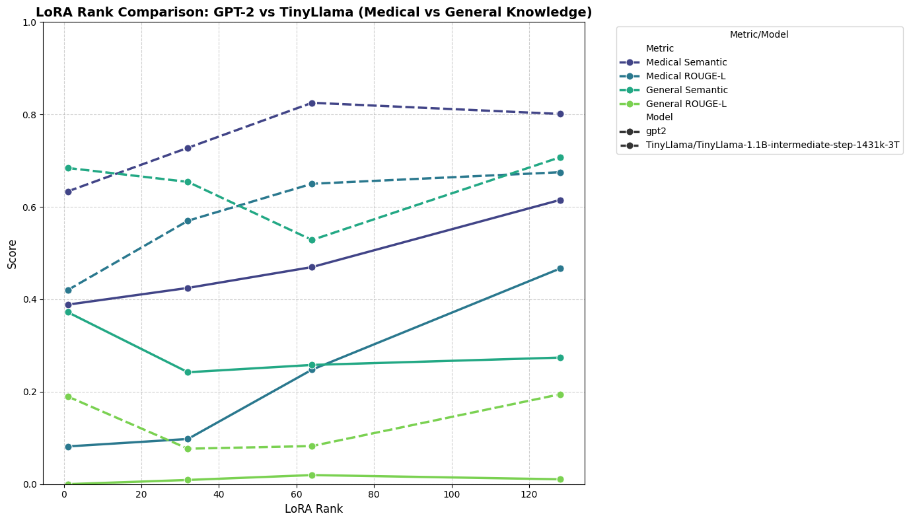
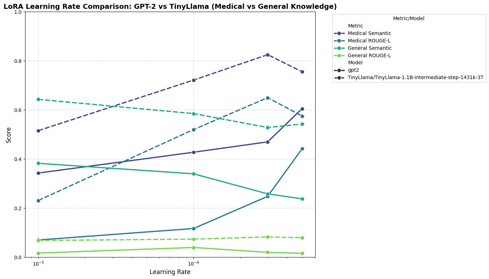
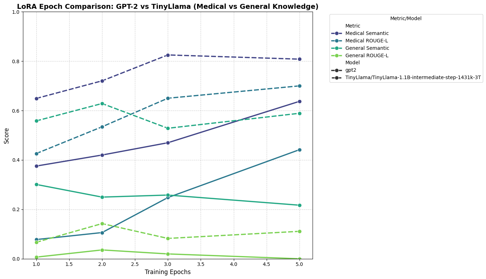

# LoRA Fine-Tuning for Medical Question Answering

This project studies how LoRA fine-tuning affects GPT-2 and TinyLlama on symptom-to-disease prediction. Given a text description of symptoms, each model generates a disease label.

I compare adapter ranks, learning rates, and training epochs to understand how these settings affect medical-task performance and performance on general-knowledge prompts.

## Technologies

Python, PyTorch, Hugging Face Transformers, PEFT, Sentence Transformers, pandas, Matplotlib, and seaborn.

## Dataset

I used the [Disease and symptoms dataset 2023](https://data.mendeley.com/datasets/2cxccsxydc/1), Version 1, contributed by Bran Stark on Mendeley Data.

The dataset contains approximately 246,000 artificially generated examples covering 773 diseases and 377 symptoms. It is available under the [CC BY 4.0 license](https://creativecommons.org/licenses/by/4.0/).

For this project, I sampled:
- 4000 rows for training
- 20 separate rows for medical evaluation

I converted binary symptom indicators into text descriptions. General-task evaluation uses 20 fixed general-knowledge prompts, separate from the dataset.

Example medical prompt:

    ### Symptoms: sharp abdominal pain, painful urination, back pain
    ### Disease:

## Experiments

Models:
- `gpt2`
- `TinyLlama/TinyLlama-1.1B-intermediate-step-1431k-3T`

Each run starts from a fresh pretrained model, with one setting varied at a time.

| Experiment | Values tested | Fixed settings |
|---|---|---|
| LoRA rank | 1, 32, 64, 128 | Learning rate: 3e-4; epochs: 3 |
| Learning rate | 1e-5, 1e-4, 3e-4, 5e-4 | Rank: 64; epochs: 3 |
| Training epochs | 1, 2, 3, 5 | Rank: 64; learning rate: 3e-4 |

LoRA alpha is twice the rank, dropout is 0.05 and training batch size is 8. All experiments use seed 42 and greedy decoding.

The pretrained models are evaluated before fine-tuning using the same evaluation examples.

## Evaluation

I used two metrics:

- **Semantic similarity:** cosine similarity between generated and reference answer embeddings from `all-MiniLM-L6-v2`, with negative values clipped to zero.
- **ROUGE-L:** a custom longest-common-subsequence F1 score using lowercased, whitespace-separated tokens.

Scores are averaged separately for medical and general tasks. They measure answer similarity rather than clinical accuracy.

## Results

The table compares pretrained performance with LoRA fine-tuning at rank 64, learning rate 3e-4, and 3 epochs.

| Model | Configuration | Medical semantic | Medical ROUGE-L | General semantic | General ROUGE-L |
|---|---|---:|---:|---:|---:|
| GPT-2 | Pretrained | 0.280 | 0.030 | 0.331 | 0.000 |
| GPT-2 | LoRA fine-tuned | 0.470 | 0.248 | 0.258 | 0.020 |
| TinyLlama | Pretrained | 0.374 | 0.039 | 0.689 | 0.048 |
| TinyLlama | LoRA fine-tuned | 0.825 | 0.650 | 0.528 | 0.082 |

### Main findings

- Both models improved on the medical evaluation examples after fine-tuning.
- GPT-2's medical scores improved across the tested ranks. Increasing epochs also improved medical scores while reducing general semantic similarity.
- TinyLlama achieved its highest medical semantic score at rank 64, learning rate 3e-4 and 3 epochs.
- TinyLlama's rank-128 run had slightly lower medical semantic similarity than rank 64, but higher medical ROUGE-L and general-task scores.
- General-task performance did not decline consistently across all settings. The results show that the adaptation–retention trade-off depends on the configuration and evaluation metric.

### Rank comparison

### Learning-rate comparison

### Epoch comparison

## How to run

1. Open `Lora_fine_tuning.ipynb` in Google Colab.
2. Select a GPU runtime.
3. Download the dataset from the source linked above.
4. Place the dataset CSV in the runtime's working directory as `disease_symptoms.csv`, or update `CSV_PATH` in the notebook.
5. Run the cells in order.

The notebook installs dependencies, downloads the models and runs the experiments. Results are saved in the `results/` directory. The current configuration does not save trained model checkpoints.

You can inspect the uploaded CSVs, plots, and saved notebook outputs without rerunning training.

## Limitations

- Evaluation includes only 20 medical examples and 20 general prompts, using one random seed.
- The row-based split does not explicitly check for duplicate symptom patterns across training and evaluation.
- The dataset is artificially generated, so results do not establish performance on real patient records.
- Answer length and punctuation can affect the custom ROUGE-L scores.
- These experiments explore general-task performance changes; they do not establish broad catastrophic forgetting or clinical reliability.

## Files

- `Lora_fine_tuning.ipynb`: experiment code and saved outputs
- `baseline_results.csv`: pretrained model scores
- `rank_results.csv`, `lr_results.csv`, `epoch_results.csv`: sweep results
- `predictions.csv`: generated answers and per-example scores
- `plot1.png`, `plot2.png`, `plot3.png`: experiment plots
